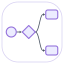
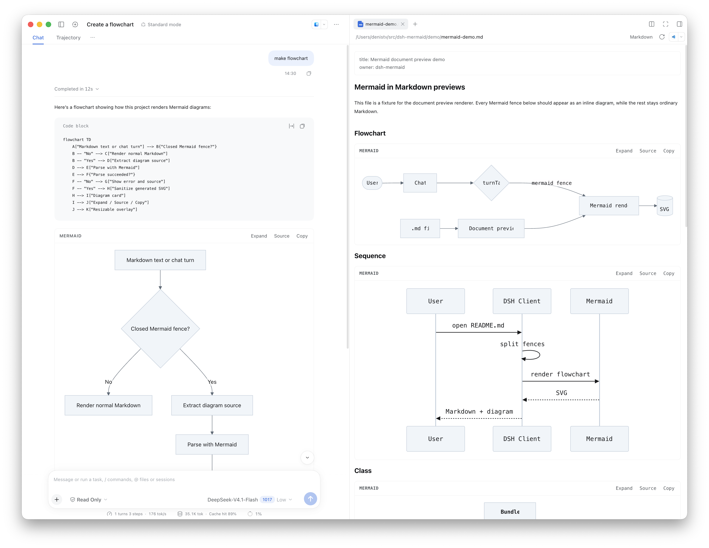
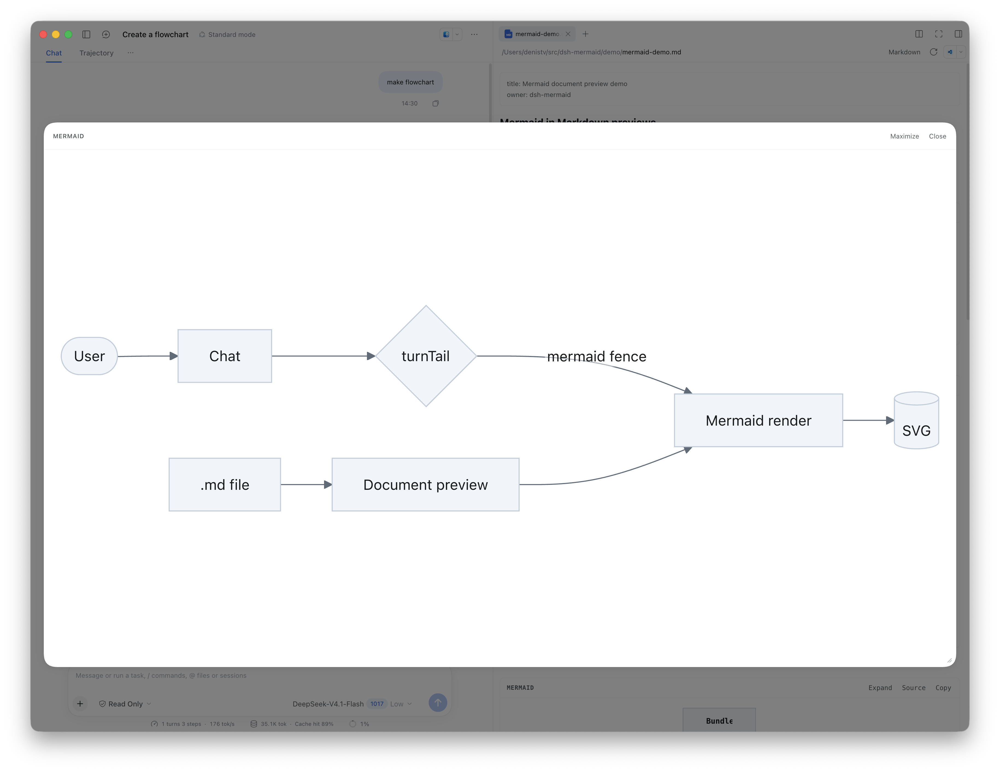
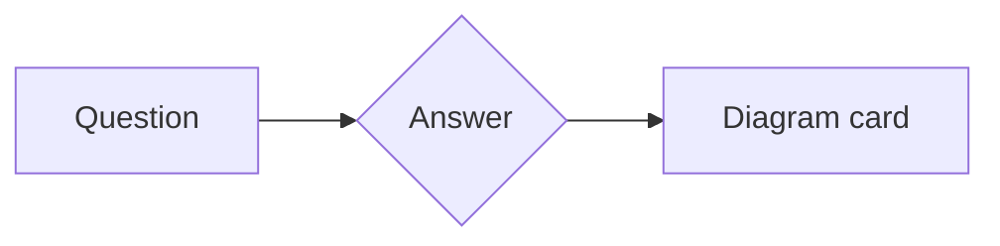
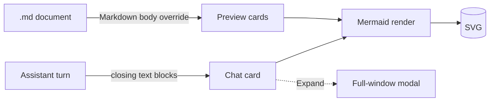

<p align="center">
  
</p>

<h1 align="center">dsh-mermaid</h1>

<p align="center">
  Mermaid diagrams in DeepSeek Harness chat and Markdown previews.<br>
  Rendered locally, themed with the shell, expandable to full size.
</p>

<p align="center">
  <a href="LICENSE"></a>
  
  
</p>



`dsh-mermaid` is a plugin bundle for **DeepSeek Harness (DSH)**. Every closed
<code>```mermaid</code> or <code>```mmd</code> fence becomes a real, interactive
diagram in two places:

- **Chat** — a diagram card appears under the assistant's answer that contains
  the fence.
- **Markdown preview** — open any `.md` file and Mermaid fences render inline,
  between the ordinary Markdown blocks.

Everything is bundled into the plugin: no CDN, no rendering service, no network
round trip. Diagrams follow the shell's light and dark theme, use the interface
font, and can be expanded into a resizable full-window view.

> **Status: 0.1.0 prototype.** Built and tested against DeepSeek Harness
> `0.2.1-rc.3`. The extension points it uses are not yet a stable public API, so
> expect small changes across harness releases.

## Features

- **Two surfaces, one runtime.** Chat and document preview share the same
  Mermaid renderer, theme tokens, and card UI.
- **Cards that stay out of the way.** Each card has **Expand**, **Source /
  Diagram**, and **Copy** controls. **Source** shows the original fence; **Copy**
  puts it on the clipboard.
- **Expandable view.** **Expand** opens a centered modal with a dimmed backdrop,
  a corner resize handle, and a **Maximize / Default size** toggle. The panel
  opens at 1120×780, resizes down to 420×300, remembers your preferred size in
  `localStorage`, and re-clamps itself when the window changes.
- **Theme-aware.** Colors are sampled from the shell's `--dsw-alias-*` tokens
  and passed to Mermaid's `base` theme; diagrams re-render on `theme/change`.
- **No second viewer.** The built-in **Markdown** preview keeps its dropdown
  entry — the plugin only replaces its body, so headings, code highlighting,
  tables, footnotes, and sanitization stay exactly as shipped.
- **Offline by design.** `mermaid`, `marked`, and `DOMPurify` are compiled into
  a single client artifact.
- **Graceful failures.** A broken diagram shows the parser error above its
  source instead of disappearing; an empty fence says so.

## Screenshots



*The same diagram expanded: resizable panel, maximize toggle, Escape or a
backdrop click to close.*

## Requirements

- **DeepSeek Harness 0.2.1-rc.3** or a compatible build. The plugin targets the
  client extension points of that version.

There is no build step for users: the browser bundle ships prebuilt and all
diagram rendering happens inside the plugin.

## Install

The plugin is not published to npm, so it is installed as a **local bundle**
from this folder. Installation links the directory into the current profile;
nothing needs to be compiled first, and the bundle ships its browser build.

### In the desktop app

1. Open **Plugins** in the sidebar.
2. Click **Add plugin**.
3. Enter the absolute path to this folder — the one that contains
   `package.json` — and press **Enter**:

   ```text
   /Users/you/src/dsh-mermaid
   ```

   On Windows the same field takes `C:\src\dsh-mermaid`.
4. Click **Install** and wait for the result screen. The Host reads the package,
   links the folder into the profile, and adds the bundle to the profile's
   bundle list.
5. Click **Enable now**. If the dialog is already closed, open the
   **dsh-mermaid** card under **Installed plugins** and switch it on.
6. Restart DSH if the page asks for it; otherwise reload the window. The client
   bundle is fetched on page load, so the plugin does not appear before that.

That is the whole setup — no configuration follows. The plugin applies to every
session in the profile and activates immediately when the bundle is on.

> **Keep the folder in place.** A local-directory install is a link, not a copy.
> Moving or deleting the folder breaks the bundle until it is reinstalled.

### From a DSH session

You can also let the agent do the same thing — ask it to install the bundle and
give it the absolute path:

> Install the plugin bundle from `/Users/you/src/dsh-mermaid`

The agent calls `plugin_manager` with `action: install_bundle` and the absolute
directory, which performs the same package installation and bundle selection as
the dialog. The call needs Full access or an approval.

### Check that it works

Open `demo/mermaid-demo.md` in the sidebar: its Mermaid fences render as
diagram cards. Or ask for a diagram in chat and look for the card under the
answer.

### Update or remove

- **Update:** local installs are linked, so after `git pull` (and
  `npm run build` if the source changed) just reload the window.
- **Remove:** open the **dsh-mermaid** card under **Installed plugins**, choose
  **Uninstall**, and confirm. The folder on disk stays where it is.

Disabling or removing the bundle unregisters both surfaces and removes every
style rule the plugin added.

## Usage

### In chat

Ask for a diagram, or paste a fence into any message. After the turn completes,
the fence is rendered as a card below the answer:

````markdown

````

Both `mermaid` and `mmd` info strings are claimed. Other languages stay plain
code blocks. Only **closed** fences render — while a message is still streaming,
an unfinished fence remains a normal code block.

Chat cards are read from the turn's durable data
(`closing.finalNode.blocks`), not scraped from the DOM, so streaming,
virtualized re-renders, pagination, and session switches cannot desynchronize
them.

### In Markdown previews

Open a `.md` / `.markdown` file in the sidebar. Mermaid fences become diagram
cards inline; the rest of the document goes through the harness's own
`MarkdownText`, so typography, syntax highlighting, and sanitization match the
built-in preview.

`demo/mermaid-demo.md` is a ready-made fixture with flowchart, sequence, class,
state, Gantt, and pie diagrams, plus a non-Mermaid fence and unsafe HTML that is
stripped.

### Controls

| Control | Where | What it does |
| --- | --- | --- |
| **Expand** | Card | Opens the diagram in the modal view. |
| **Source / Diagram** | Card | Toggles between the rendered SVG and the original fence. |
| **Copy** | Card | Copies the diagram source to the clipboard. |
| **Maximize / Default size** | Modal header | Fills the available frame or returns to the saved size. |
| **Close** | Modal header | Closes the modal; Escape and a backdrop click do the same. |

The expanded view is registered in the root `shell.overlay` layer rather than
inside the transcript, because the transcript clips its overflow and may
animate with transforms — either would trap a fixed-position child. Focus moves
into the dialog on open and returns to the trigger on close.

## How it works



| Surface | Extension point | Notes |
| --- | --- | --- |
| Chat | `conversation.chat.turnTail` (order 35) | One cell per turn; reads durable message blocks. |
| Document | `sidebar.right.tab.document` | Shadows the shipped Markdown body at priority `-1` under its own key, so the viewer dropdown keeps a single **Markdown** entry. |
| Modal | `shell.overlay` | Click-through layer; the overlay root opts back into pointer events. |

The whole client is one bundle: `mermaid`, `marked`, and `DOMPurify` are
compiled into it, and only React stays external because the harness supplies it.
Nothing is fetched at runtime, so diagrams render offline.

If the harness ever stops exposing `MarkdownText`, the document body falls back
to the bundled `marked` + `DOMPurify` renderer instead of going blank. If a
future harness adds a public code-fence renderer registry, the body override
should be replaced by it.

Every registration lives under an effect, including the stylesheet, so
disabling the plugin removes its cards, its overlay, and every rule it added.

## Compatibility and limitations

- **Chat cards are appended, not substituted.** This harness version has no
  public fence renderer, so the original code block stays visible above the
  diagram. Replacing the whole assistant step would shadow the shipped message
  UI.
- **Closed fences only.** An unfinished fence stays a code block until its
  closing line arrives.
- **The preview override is version-sensitive.** It targets the shipped
  Markdown body id. If a future harness renames that id or changes the body
  contract, the override becomes inert and the untouched built-in viewer
  returns.
- **Frontmatter** is shown verbatim in a small block instead of the built-in
  field list.
- **Splitting at fence boundaries** can break reference-style link or footnote
  definitions that live on the opposite side of a diagram.
- **Expanded view** fits the diagram to the panel: no pan and no incremental
  zoom yet. The resize handle is pointer-only; the header's **Maximize** button
  is the keyboard-friendly path.
- **Very large diagrams** can take a moment to lay out, because renders are
  serialized to protect Mermaid's shared layout state.
- **Coexistence.** Another chat plugin that appends diagram cards (for example
  `@baconbao/dsh-mermaid-image-preview`) will add a second card for the same
  fence. Keep one of them enabled. On the document side there is no second
  viewer entry to collide with.

## License

[MIT](LICENSE) © dsh-mermaid contributors.
