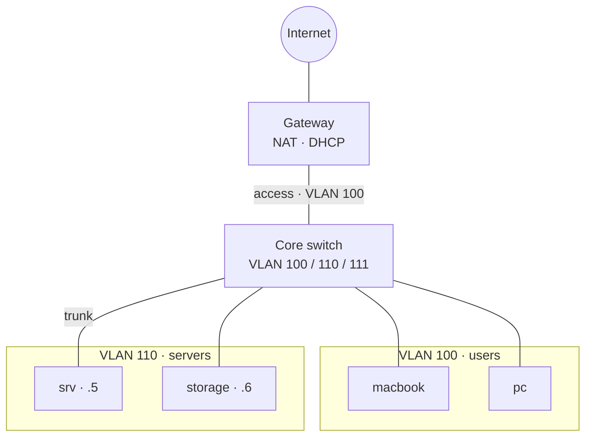
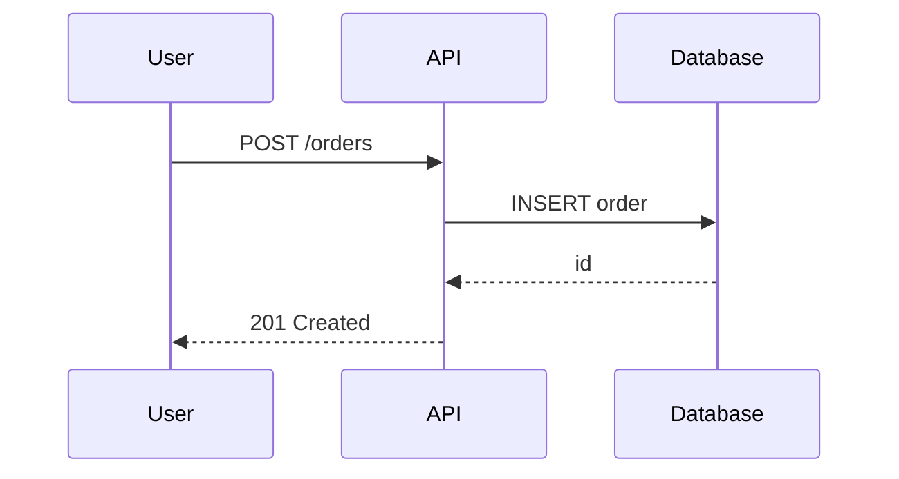
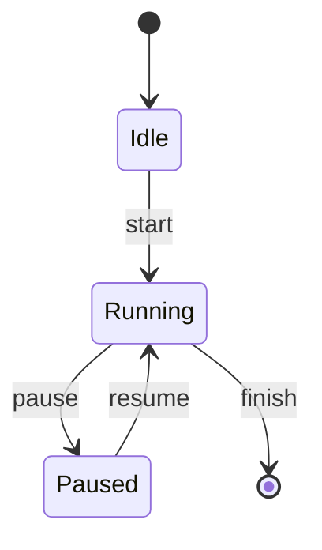
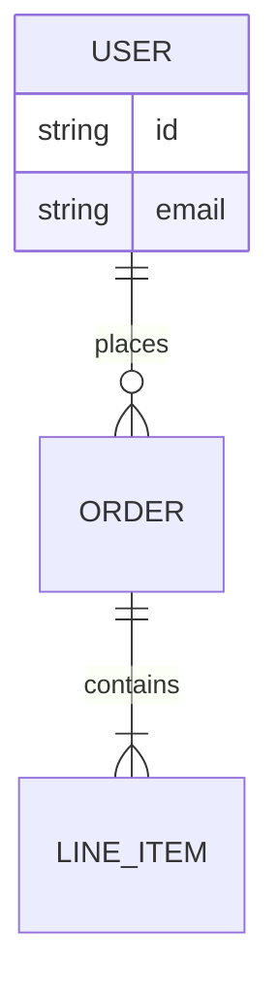
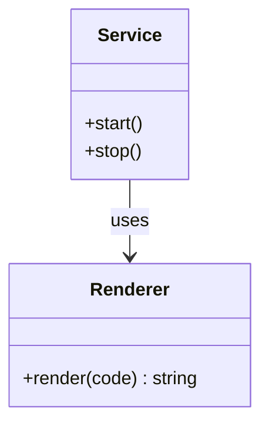
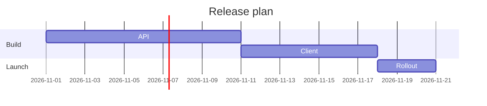
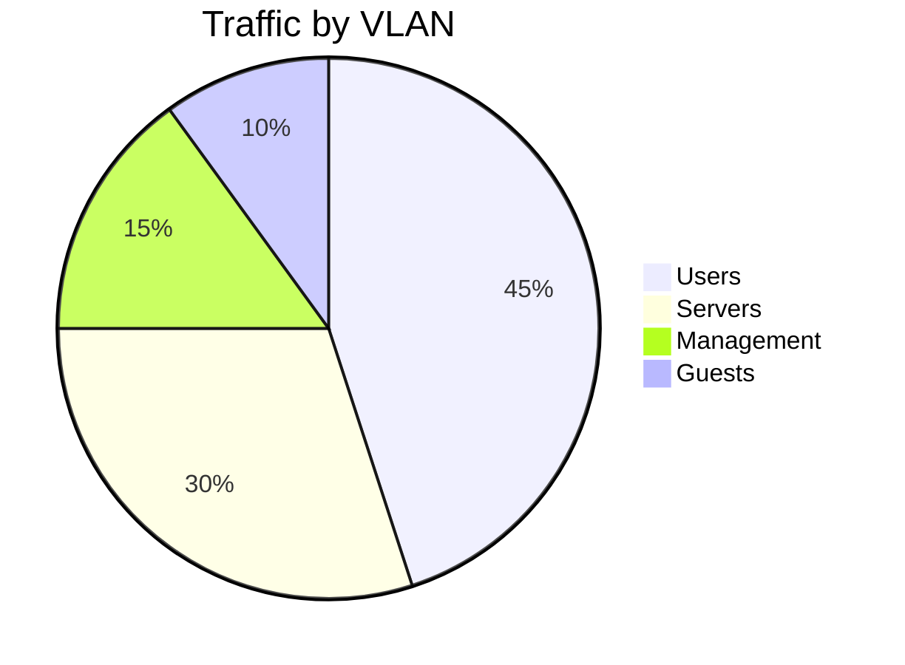

# Mermaid diagrams

DSH renders Mermaid fences as interactive cards in chat and in Markdown
previews. Your job is to produce a **closed fenced block whose info string is
exactly `mermaid`** (or `mmd`), with valid Mermaid 11 syntax. The client renders
it after the assistant turn ends.

## Output contract

1. Emit exactly one closed fence per diagram:

   ```mermaid
   flowchart TB
       A[Start] --> B[Done]
   ```

2. The opening line must be exactly ```` ```mermaid ```` — not
   ```` ```flowchart ````, ```` ```mermaid.js ````, ```` ``` ````, or a
   `json`/`text` block that happens to contain Mermaid.
3. Put the fence in the **final assistant message**, outside reasoning and
   outside tool calls. A diagram in reasoning or in a tool result is invisible
   to the chat renderer.
4. Put nothing else on the fence lines. Do not put prose inside the block.
5. Close the fence. While streaming, an unfinished fence stays a code block and
   never becomes a card.
6. One diagram per fence. For several diagrams, use several fences.
7. Do not wrap the fence in a larger code block and do not escape it.

## Choose the right diagram

| Need | Type | First line |
| --- | --- | --- |
| Architecture, dependencies, process | Flowchart | `flowchart TB` or `flowchart LR` |
| Ordered messages between actors | Sequence | `sequenceDiagram` |
| Lifecycle, state machine | State | `stateDiagram-v2` |
| Database schema | ER | `erDiagram` |
| Types and relationships | Class | `classDiagram` |
| Timeline with durations | Gantt | `gantt` |
| Proportions | Pie | `pie title ...` |
| Taxonomy or ideas | Mindmap | `mindmap` |

Prefer `flowchart` over the legacy `graph` spelling. Prefer `TB` for
architecture and `LR` for pipelines.

## Syntax rules for this renderer

- Wrap node text in double quotes when it contains spaces, punctuation,
  Unicode, `/`, `:`, `·`, `—`, parentheses, or `<br/>`:
  `A["VLAN 100 · 192.168.100.0/24"]`.
- Use `<br/>` for line breaks inside a label; do not use `\n` or literal newlines.
- Use quoted edge labels: `A -->|"trunk 100 / 110"| B`.
- Keep node IDs short and ASCII: `INET`, `SW`, `SRV`. Put the human text in the
  quoted label.
- Write prose and labels in the user's language, but keep Mermaid keywords
  (`flowchart`, `subgraph`, `end`, `sequenceDiagram`) in English.
- Declare subgraph IDs and titles explicitly:
  `subgraph L100["VLAN 100 · users"]`.
- Close every `subgraph` with `end`.
- Do not use raw HTML other than `<br/>`. No `<script>`, `<iframe>`, ``,
  `click` handlers, external icons, or remote images.
- Do not use `%%{init: ...}%%` or other directives; DSH owns the theme and
  security level.
- Avoid decorative `classDef`/`style` blocks unless they are essential; the
  shell supplies the palette.
- Prefer 10–30 nodes. Split a larger model into several diagrams rather than
  producing one unreadable canvas.
- If a label contains `"`, use `&quot;` or rewrite the label without quotes.

## Type-specific patterns

### Flowchart with subgraphs



Use `---` for undirected links, `-->` for directed links, and
`-.->` for optional flows.

### Sequence



### State machine



### ER model



### Class model



### Gantt



### Pie



## Before sending

- The opening line is ```` ```mermaid ```` and the closing line is ```` ``` ````.
- The block is in the final visible answer, not in reasoning.
- The diagram uses a supported type and has balanced `subgraph`/`end` pairs.
- Every label with punctuation is quoted.
- The source is not wrapped in another fence and is not truncated.

If the user asks to "show the diagram as an image", still emit the Mermaid fence;
DSH turns it into a rendered SVG card locally.

