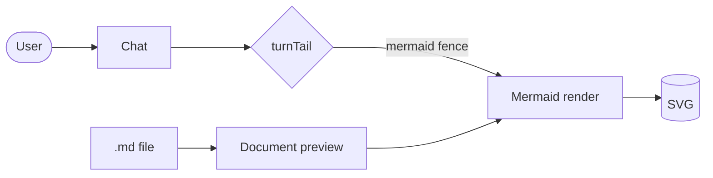
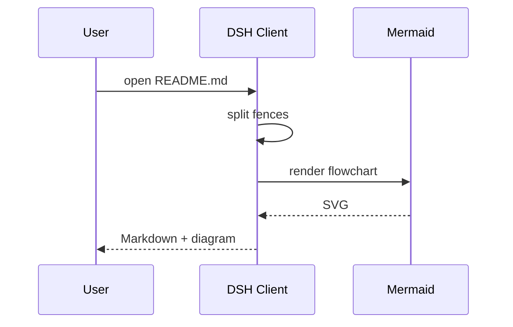
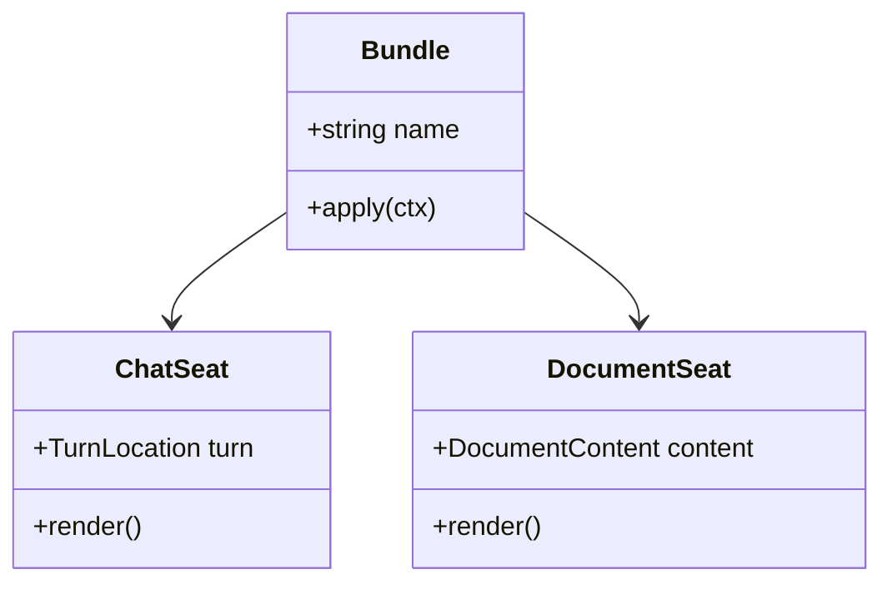
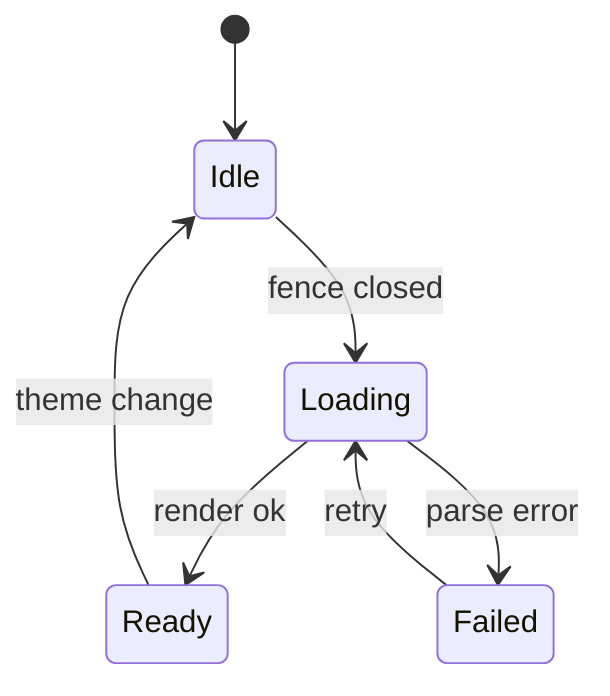
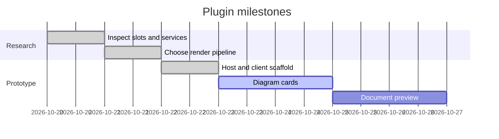
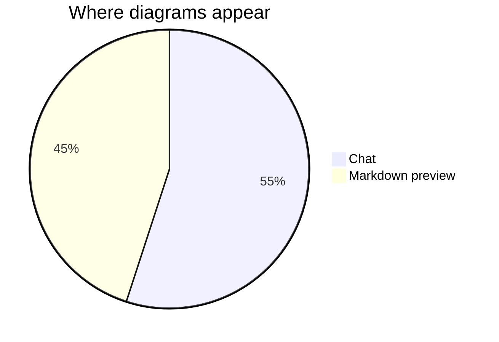

# Mermaid in Markdown previews

This file is a fixture for the document preview renderer. Every Mermaid fence
below should appear as an inline diagram, while the rest stays ordinary
Markdown.

## Flowchart



## Sequence



## Class



## State



## Gantt



## Pie



## Non-Mermaid fences stay code

```js
const bundle = {
  name: 'dsh-mermaid',
  surfaces: ['chat', 'markdown-preview'],
};
```

> Blockquotes, **bold**, _italic_, `inline code`, tables, and lists all go
> through `marked` + `DOMPurify`.

| Surface | Extension point | Loading mode |
| --- | --- | --- |
| Chat | `conversation.chat.turnTail` | durable turn data |
| Markdown | `documentPreviews` + `sidebar.right.tab.document` | `text-pages` |

Unsafe HTML is removed:

<script>alert('never runs')</script>
